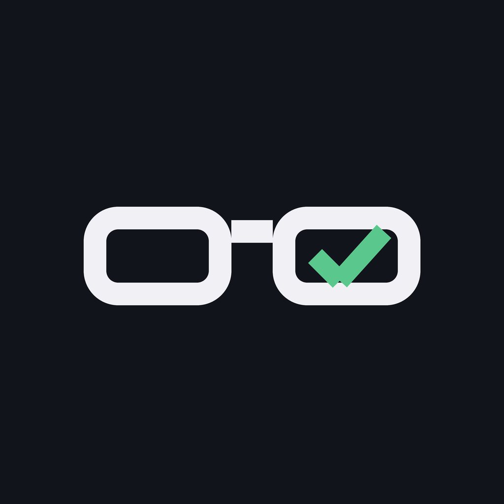
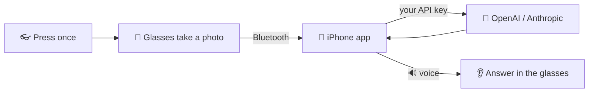

# Cheating Tool

**Press the button on your Ray-Ban Meta. The glasses photograph the problem. The answer plays in your ears.**

Your phone stays in your pocket.

[Install](#install) · [How to use it](#how-to-use-it) · [Troubleshooting](#troubleshooting) · [Privacy](#privacy) · [Guide on the web](https://www.andriidrok.com/glasses)

> [!NOTE]
> On your phone and in TestFlight the app is called **Glasses Tutor**. That’s on purpose: if anyone looks at your home screen, it’s just a tutor app.

## How it works

The app talks to the glasses through Meta’s [Wearables Device Access Toolkit](https://github.com/facebook/meta-wearables-dat-ios). There is no server in between: the photo goes from your phone straight to the AI provider you pick, with your own key.

## What you need

- An iPhone on iOS 17.2 or newer
- Ray-Ban Meta or Oakley Meta glasses, already paired in the Meta AI app
- Your own OpenAI or Anthropic API key. A photo costs 1 to 3 cents, so $5 of credit goes a long way
- About 10 minutes

## Install

**1. Install the app with TestFlight.** The app is in beta, so it lives in TestFlight (Apple’s official app for betas) rather than the App Store. Open the link on your iPhone, get TestFlight when it asks, then tap **Accept** and **Install**. TestFlight installs new versions on its own.

<a href="https://testflight.apple.com/join/x6D22vsz"><b>→ Open in TestFlight</b></a>

**2. Turn on Developer Mode in Meta AI.** The glasses only let in apps from Meta’s store unless this is on. In the Meta AI app go to **Settings → App Info** and tap **App version** five times. A **Developer Mode** toggle appears: turn it on and confirm with **Enable**.

**3. Connect the app to your glasses.** Open Glasses Tutor. The **Setup** card at the top lists the steps and ticks each one off. Tap **Open Meta AI to connect**, confirm in Meta AI, and it sends you back.

**4. Allow the glasses camera.** Tap **Open Meta AI, choose Allow always** and pick **Allow always** in Meta AI. Otherwise it asks every time.

**5. Paste your AI key.** For OpenAI:

1. Sign in at [platform.openai.com](https://platform.openai.com/settings/organization/billing/overview) and add $5 under Billing
2. Open [API keys](https://platform.openai.com/api-keys), tap **Create new secret key** and copy it (it starts with `sk-`)
3. Paste it into the field in step 4 of the Setup card

The key stays in your iPhone’s Keychain. Using Anthropic instead? Switch **Provider** and get a key at [console.anthropic.com](https://console.anthropic.com/settings/keys).

**6. Agree to sending photos.** Turn on **I agree**. Once every step has a tick, the Setup card goes away and you’re ready.

## How to use it

Everything happens with one button: the capture button on top of the right arm of your glasses. Open the app so it connects, then put the phone away.

| Press | What it does |
|---|---|
| **Once** | Takes a photo of what you’re looking at and sends it to the AI |
| **Twice** | Plays the answer. While it talks: pause. Paused: continue. Finished: repeat |

### One round

1. **Press once.** You hear a short click. The photo is on its way.
2. **Wait a few seconds.** The glasses say *“Ready”* and your phone buzzes once. Nothing is read out yet, so nobody around hears it by surprise.
3. **Press twice.** The answer plays in your ears.

Want the answer read right away? Turn on **Speak answer immediately** in the **Answer** section.

### What it tells you

It reads the question, looks at what you wrote under it, and gives one short line.

| On the page | You hear |
|---|---|
| Nothing written yet | *“1 A”* or *“3: x equals 4”* |
| Your answer, and it’s right | *“1 correct”* |
| Your answer, and it’s wrong | *“1 incorrect. v2 second entry should be 0, not 1”* |
| A question with parts | *“Part a: 3. Part b: infinitely many. Part c: B”* |
| A photo it can’t read | *“Photo unreadable, try again”* |

It’s tuned for math (algebra, linear algebra, matrices, multiple choice). Other subjects work too, just less reliably.

### Tips

- **One question only:** point at it with a fingertip or pen tip, or hover the mouse cursor over it on a screen. It answers just that question, or just that part, like (b).
- **A problem across two pages:** it remembers your last 3 photos for 20 minutes. Photograph the page with the matrix, then the page with the question. Starting a different assignment? Tap **Forget earlier photos**.
- **A good photo:** face the page straight on, get close enough that the problem fills most of the view, hold still for a second after the click, avoid glare.
- **Settings:** **Language** (English or Russian, follows your iPhone), **Speech rate**, and **Last photo / Last answer** to see what it saw and the full worked solution.
- The light on the front of the glasses turns on while a photo is taken. Meta does that, and the app can’t turn it off.

## Troubleshooting

<b>Meta AI opens but the connection fails</b>

Check that Developer Mode is on, then update Meta AI and the glasses firmware.

<b>The button on the glasses does nothing</b>

Open the app and tap **Reconnect glasses**. Under **Status**, **Capture button** should say *listening*.

<b>A key error or 401 in the answer</b>

The key was cut off when you copied it, or your OpenAI account has no credit.

<b>Anything else</b>

[Open an issue](https://github.com/andriidrok1/glasses-tutor/issues) or DM me on Instagram.

## Privacy

No server, no account, no analytics. Photos go from your phone directly to OpenAI or Anthropic under your own key, and only after you turn on **I agree**. The key lives in the iPhone Keychain, and the last 20 photos stay in the app’s folder on your phone. Full policy: [PRIVACY.md](PRIVACY.md).

## Build from source

SwiftUI app, project generated with [XcodeGen](https://github.com/yonaskolb/XcodeGen) from `project.yml`, Meta Wearables DAT 1.0.1.

| File | What it does |
|---|---|
| `Sources/GlassesController.swift` | Session with the glasses, camera, full-size photo, capture button |
| `Sources/Tutor.swift` | Request to OpenAI or Anthropic with the image, the prompts |
| `Sources/Speaker.swift` | Speech through `AVSpeechSynthesizer`, routed to the glasses |
| `Sources/AppModel.swift` | Glue: settings, photo memory, answer flow |
| `Sources/ContentView.swift` | Setup card, status, settings, log |
| `.github/workflows/` | Unsigned IPA on every push, signed TestFlight upload on demand |

Building on Linux without a Mac, sideloading with a free Apple ID, and notes from testing on live glasses are in [docs/DEVELOPMENT.md](docs/DEVELOPMENT.md) (in Russian).

Made by <a href="https://www.andriidrok.com">Andrii Drok</a> in San Francisco

